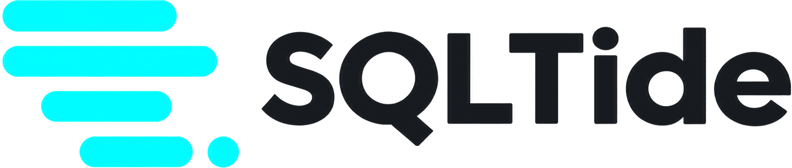
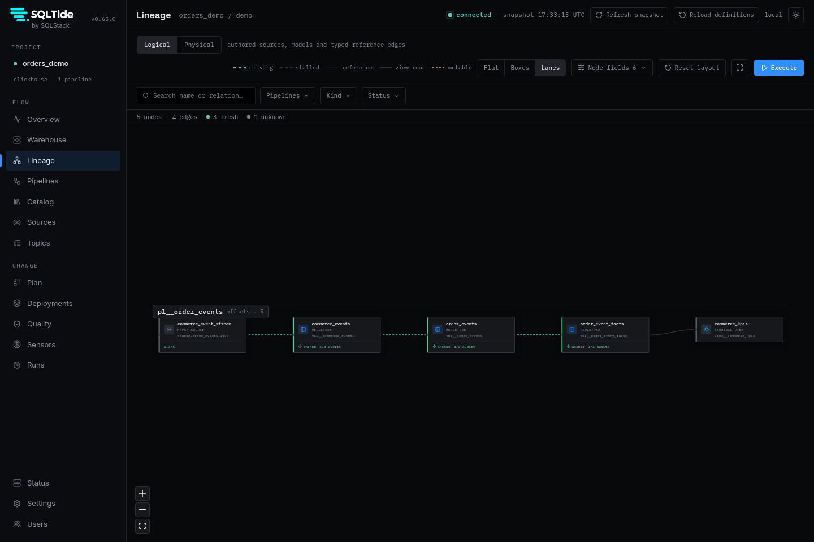

<p align="center">
  <picture>
    <source media="(prefers-color-scheme: dark)" srcset="https://raw.githubusercontent.com/sqlstack-io/sqltide/main/website/public/assets/logo-dark.png">
    
  </picture>
  <br>
  <sub>by <a href="https://sqlstack.io">SQLStack</a></sub>
</p>

<h2 align="center">Streaming pipelines for ClickHouse, in typed SQL.</h2>

<p align="center">
  <strong>Change your SQL, see exactly what will rebuild, and replay it from retained stream history.</strong>
  <br>
  <a href="https://sqltide.io">Website</a> ·
  <a href="https://sqltide.io/demo/">Demo</a> ·
  <a href="https://sqltide.io/docs/cli/playground/">Playground</a> ·
  <a href="https://sqltide.io/docs/quickstart/">Get started</a> ·
  <a href="https://sqltide.io/docs/">Docs</a>
</p>

<p align="center">
  <a href="https://pypi.org/project/sqltide/"></a>
  <a href="https://github.com/sqlstack-io/sqltide/actions/workflows/verify.yml"></a>
  <a href="https://pypi.org/project/sqltide/"></a>
  <a href="https://github.com/sqlstack-io/sqltide/blob/main/LICENSE"></a>
</p>

SQLTide brings dbt-style authoring and deployment to streaming. Models compile into ClickHouse
tables and materialized views, every build shows its plan first, and a change to your logic is
rebuilt from retained Kafka history.

```bash
uv tool install sqltide        # or: pip install sqltide
sqt playground                 # create an orders project and start it with Docker
```

`sqt playground` creates a small orders project you run on your own machine with Docker: plan a
change, build it as a candidate beside the live version, then promote it without changing the
consumer's query. Add `--template streaming` for the same workflow over live order events from
Redpanda. Each project's `README.md` walks through every command; see the
[playground reference](https://sqltide.io/docs/cli/playground/).

To look around the development UI before installing anything, open the
[UI demo](https://sqltide.io/demo/): the same UI in your browser. In desktop Chrome, Edge and
Firefox it runs a real ClickHouse engine in the page, so you can promote a staged change and watch
the query switch.



## Key features

- **Typed SQL models.** Explicit output types, `__source()` and `__ref()` dependencies, and offline
  compilation with no warehouse connection.
- **Replay-aware builds.** Affected models are reconstructed from retained stream history.
- **Plans before changes.** `sqt plan` is read-only, and `sqt build` replans against current
  warehouse state before it runs.
- **Staged deployments.** Build virtually, then audit, promote, and roll back.
- **Quality built in.** SQL tests, audits, sensors, and [SQLClean](https://github.com/sqlstack-io/sqlclean)
  rules and formatting.
- **A UI for operating it.** Sources, lag, lineage, plans, runs, and quality in `sqt dev`, with
  trusted-proxy or password authentication for shared installations.

## Example

A source and a model:

```yaml
sources:
  - name: orders
    kind: kafka
    broker_list: kafka:9092
    topic: source.orders
    replay_boundary:
      mode: offsets
```

```sql
MODEL (
  engine "MergeTree()",
  order_by ["order_id", "_replay_partition", "_replay_offset"],
);

SELECT
  order_id::String AS order_id,
  _replay_partition::Int32 AS _replay_partition,
  _replay_offset::Int64 AS _replay_offset,
  _replay_timestamp::DateTime64(3) AS _replay_timestamp
FROM __source("orders")
```

## Quick start

```bash
sqt discover    # inspect authored resources
sqt compile     # validate offline
sqt plan        # read-only warehouse plan
sqt build       # confirm and execute
sqt test
sqt audit
sqt dev         # local UI at 127.0.0.1:8000
```

`sqt playground` runs this workflow on a ready-made project locally with Docker; the
[quickstart](https://sqltide.io/docs/quickstart/) walks through it step by step.

## Documentation

- [Models](https://sqltide.io/docs/concepts/models/) and [pipelines](https://sqltide.io/docs/concepts/pipelines/)
- [Replay and lineage](https://sqltide.io/docs/concepts/replay-lineage/)
- [Deployments](https://sqltide.io/docs/concepts/deployments/)
- [Destructive operations](https://sqltide.io/docs/concepts/destructive-operations/)
- [Project configuration](https://sqltide.io/docs/concepts/project-configuration/)
- [SQL Rules and formatting](https://sqltide.io/docs/concepts/sql-rules/)
- [Changelog](CHANGELOG.md) and [contributing](CONTRIBUTING.md)

## License

Apache-2.0
